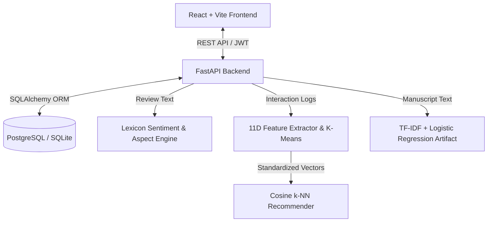

# Scribe & Spire

A full-stack literary publishing and reading platform integrating review sentiment analysis, reader habit clustering, and collaborative filtering recommendations.

## Overview

Digital publishing platforms often lack actionable reader reception analytics for authors and rely on opaque, click-driven recommendation heuristics. Scribe & Spire addresses this by pairing an engagement-verified reading pipeline with deterministic literary sentiment analysis, adaptive K-Means reader clustering, and cosine-distance $k$-Nearest Neighbors ($k$-NN) recommendations.

## Machine Learning Implementation

The platform incorporates four distinct analytical modules implemented in Python using Scikit-learn and NumPy:

1. **Review Sentiment & Aspect Analysis:** Evaluates reader reviews using a literary domain lexicon with negation handling (intensity modifier $-0.8$) and length dampening ($\sqrt{N}$). Maps feedback across four narrative aspects: Characterization, Plot & Pacing, Worldbuilding & Atmosphere, and Prose & Style.
2. **Reader Habit Clustering:** Constructs an 11-dimensional numerical vector for each user capturing session frequency, average completion percentage, bookmarks, reviews, rating tendencies, and genre shares. Clusters readers via adaptive K-Means ($k \in [1, 4]$) into behavioral personas.
3. **Collaborative Recommendations:** Identifies proximate readers in the standardized 11D habit space using $k$-NN with cosine distance ($k \le 4$). Ranks unread titles by weighting neighbor similarity against reading depth and review score:

$$S(b) = \sum_{u \in \mathcal{N}_k} (1 - d_{\text{cosine}}(t, u)) \cdot \left(\frac{P_{u,b}}{100}\right) \cdot \left(\frac{R_{u,b}}{5}\right)$$

where $d_{\text{cosine}}(t, u)$ is the cosine distance between target user $t$ and neighbor $u$, $P_{u,b}$ is completion progress, and $R_{u,b}$ is the explicit rating.

4. **Supervised Genre Classification:** Pretrained TF-IDF vectorizer (20,000 features, unigram + bigram) paired with multi-class Logistic Regression trained on the CMU Book Summary Dataset across 143 genre classes for automated tagging.

| Pipeline | Model / Algorithm | Input Dimensions | Primary Output | Dataset / Source | Evaluation Metrics |
| :--- | :--- | :--- | :--- | :--- | :--- |
| **Sentiment Analysis** | Lexicon scoring & Aspect heuristic | Raw review text & star rating | Polarity $[-1.0, 1.0]$, 4 aspect scores | Domain literary lexicon | N/A (Rule-based; no labeled ground truth) |
| **Reader Clustering** | Adaptive K-Means ($k=1..4$) | 11D standardized habit vector | Cluster ID & Persona archetype | Dynamic reader session logs | Inertia, Silhouette score ($k > 1$) |
| **Book Recommendation** | Cosine-distance $k$-NN ($k \le 4$) | 11D scaled reader feature matrix | Ranked candidate book IDs | Historical user-book interactions | N/A (Online heuristic scoring) |
| **Genre Tagging** | TF-IDF + Logistic Regression | Manuscript title & synopsis text | Ranked genre taxonomy tags | CMU Book Summaries (~16.8k entries) | Checkpointed artifact (`genre_classifier.joblib`) |

## Key Features

- **Engagement-Gated Reviews:** Validates reader interaction metrics before review submission to prevent spam and ensure credible feedback.
- **Author Reception Analytics:** Delivers review polarity distributions, aspect breakdowns, and rating trends exclusively to manuscript owners.
- **Behavioral Reader Personas:** Automatically profiles readership patterns into archetypes (e.g., *Devoted Completers*, *Casual Story Seekers*).
- **Personalized Discovery:** Generates tailored top picks using $k$-NN neighbor overlap with fallback to catalog popularity for cold-start readers.
- **Distraction-Free Reader:** Provides continuous reading session logging, automated progress persistence, and chapter navigation.

## Architecture



## Technology Stack

| Layer | Technologies | Role in System |
| :--- | :--- | :--- |
| **Frontend** | React 18, Vite, Axios | Responsive client, author analytics dashboard, reading interface |
| **Backend** | FastAPI, Pydantic, SQLAlchemy | Asynchronous REST endpoints, JWT authentication, data validation |
| **Database** | PostgreSQL, SQLite (local test) | Relational persistence for books, chapters, progress, and reviews |
| **Machine Learning** | Scikit-learn, NumPy, Joblib | Feature standardization, K-Means clustering, $k$-NN, TF-IDF inference |
| **Deployment** | Vercel Serverless, Neon | Production cloud hosting for frontend and serverless Python API |

## Quick Start

### Backend

```bash
cd backend
python -m venv .venv
source .venv/bin/activate  # Windows: .venv\Scripts\activate
pip install -r requirements.txt
uvicorn main:app --reload --port 8000
```

### Frontend

```bash
cd frontend
npm install
npm run dev
```
